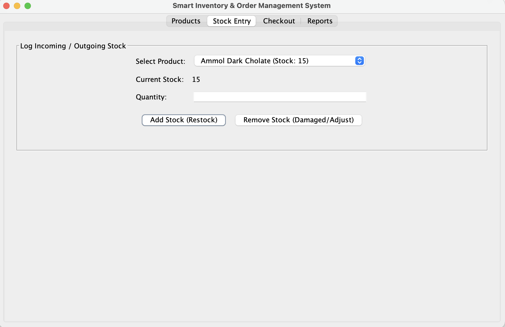
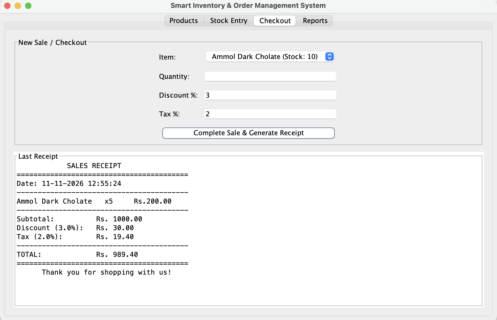
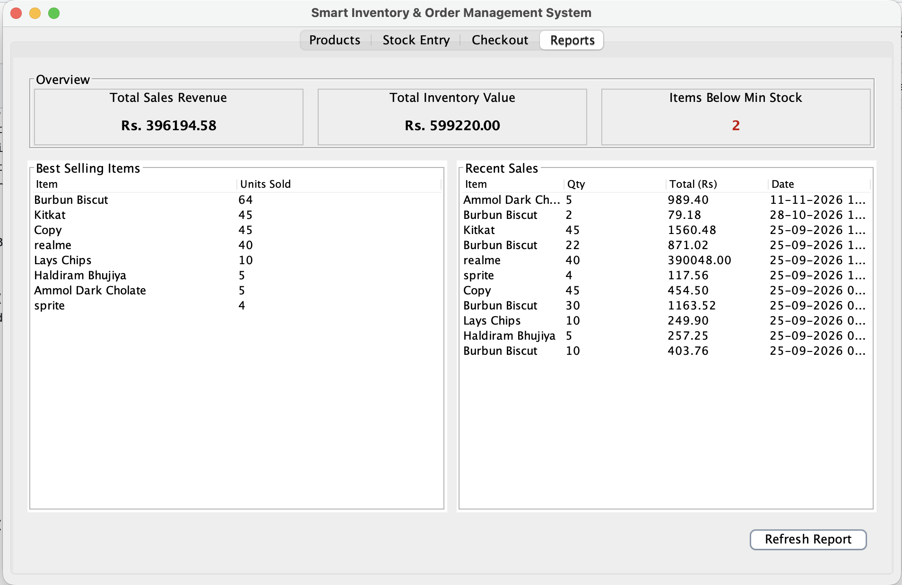

cat > README.md << 'EOF'
# Smart Inventory & Order Management System

Desktop application built with **Java Swing** and **SQLite (JDBC)** for tracking stock, logging purchases/sales, warning on low stock, and generating simple receipts.

## Screenshots

| Products | Stock Entry |
| --- | --- |
|  |  |

| Checkout | Reports |
| --- | --- |
|  |  |

## Features
- Product catalog: name, category, price, stock, min reorder level
- Stock in/out entry with logging
- Low-stock visual warnings (red rows in table + alert popup)
- Checkout with discount %, tax %, automatic stock deduction and a text receipt saved to file
- Reports: total sales revenue, current inventory value, best sellers, recent sales list

## Tech Stack
Java, Swing, SQLite, JDBC, DAO pattern

## Requirements
- Java JDK 8 or higher (`java -version` to check)
- No database setup needed. The SQLite driver is included in `lib/sqlite-jdbc.jar`.

## How to Run

### Mac / Linux
```bash
chmod +x run.sh
./run.sh
```

### Windows
Double-click `run.bat` (or run it from cmd inside this folder).

### Manual (any OS)
```bash
mkdir -p bin
javac -cp lib/sqlite-jdbc.jar -d bin src/*.java
java -cp "lib/sqlite-jdbc.jar:bin" Main
```
On Windows use `;` instead of `:` in the classpath and `mkdir bin` to create the folder.

An `inventory.db` file is created automatically in the project folder on first run.

## Project Structure
```
InventoryApp/
├── lib/
│   └── sqlite-jdbc.jar
├── src/
│   ├── Main.java           -> entry point
│   ├── MainWindow.java     -> main window with 4 tabs
│   ├── DBHelper.java       -> SQLite connection + table creation
│   ├── Product.java        -> product model
│   ├── ProductDAO.java     -> product CRUD + stock updates
│   ├── SalesDAO.java       -> checkout/sales + report queries
│   ├── ProductPanel.java   -> "Products" tab (catalog, add/delete)
│   ├── StockPanel.java     -> "Stock Entry" tab (restock/remove)
│   ├── CheckoutPanel.java  -> "Checkout" tab (billing, receipt)
│   └── ReportsPanel.java   -> "Reports" tab (revenue, best sellers)
├── screenshots/
├── run.sh
└── run.bat
```

## Demo Flow
1. **Products** tab: add 3-4 items with realistic minimum stock levels (e.g. 10).
2. **Stock Entry** tab: restock an item and watch the stock update.
3. **Checkout** tab: sell an item until it drops below its minimum level to see the low-stock popup.
4. **Reports** tab: check total revenue and best sellers updating live.

## Author
Raunak ([@Raunak2810](https://github.com/Raunak2810))
EOF 
